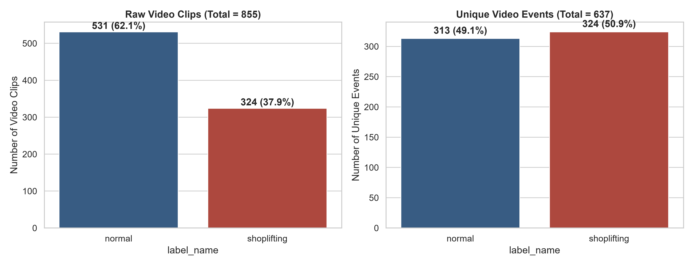
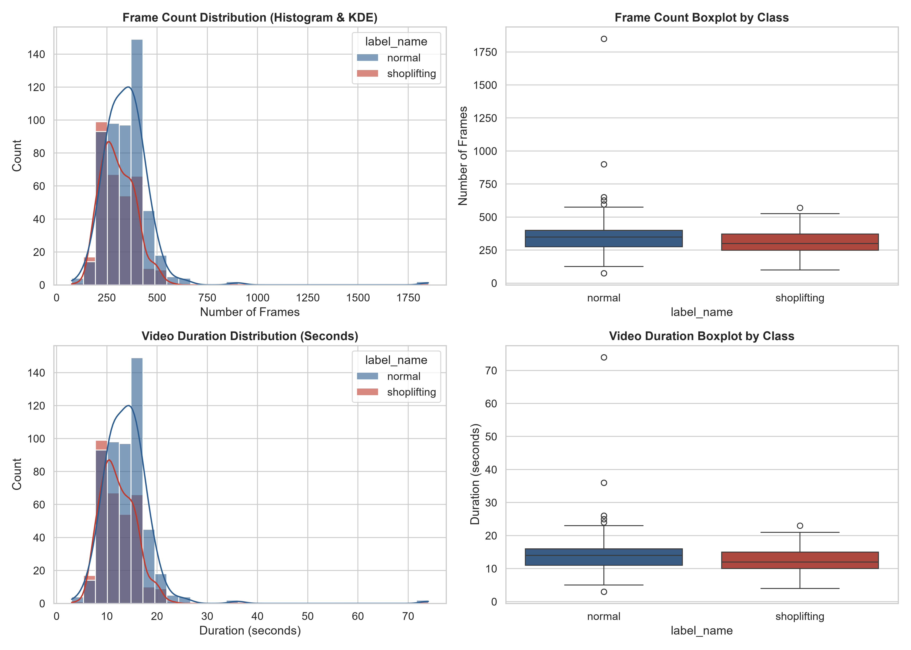
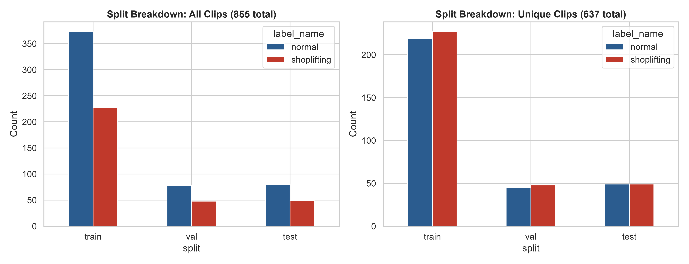
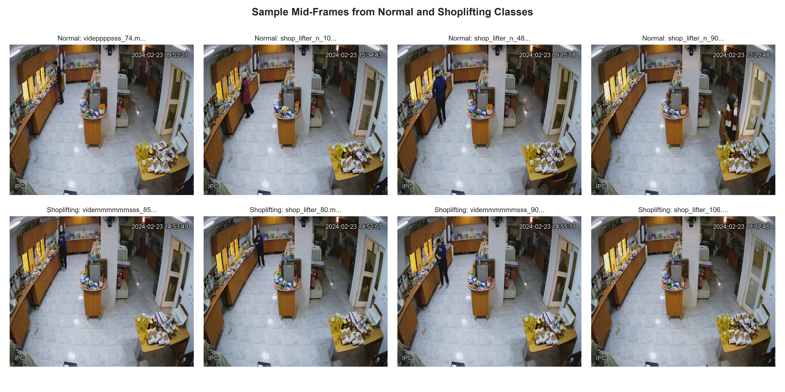
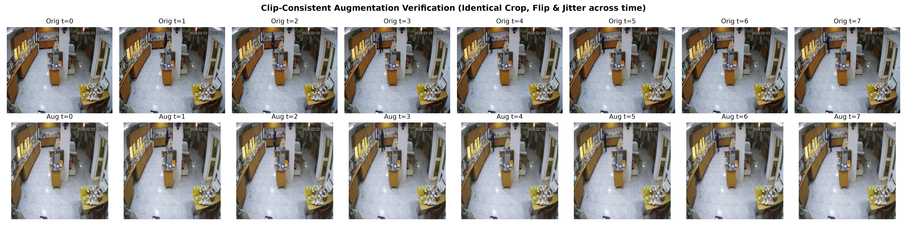
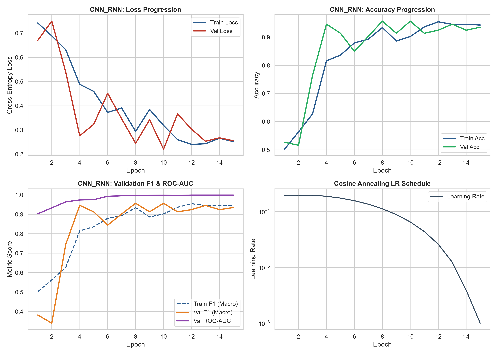
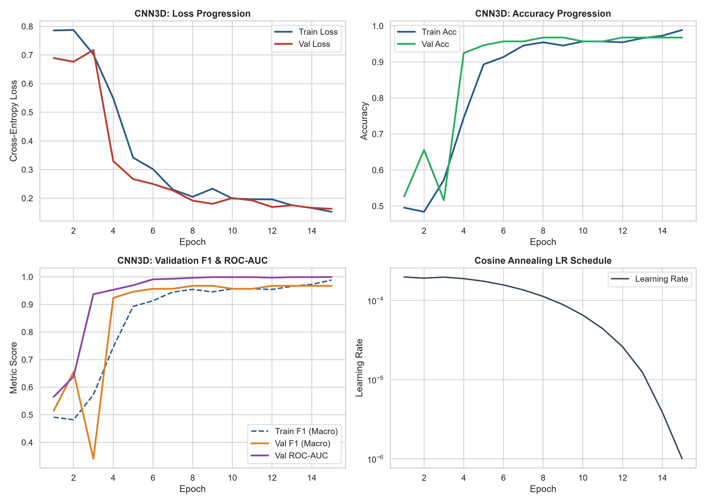
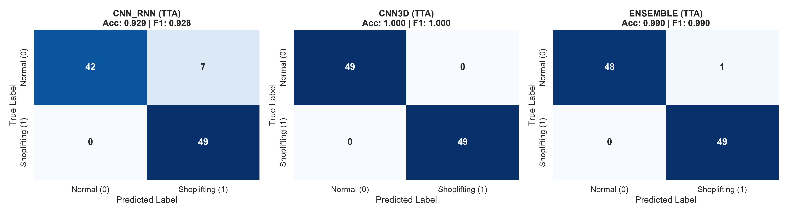
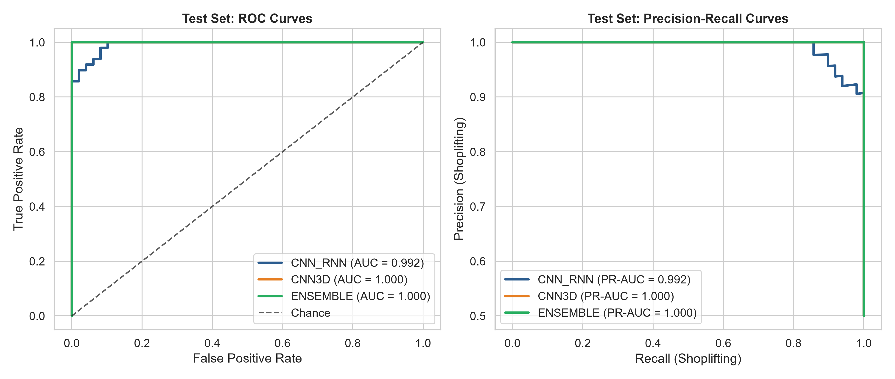

# Shoplifting Detection in Surveillance CCTV Footage

[](https://pytorch.org/)
[](https://www.python.org/)
[](LICENSE)
[](https://developer.nvidia.com/cuda-zone)

An enterprise-grade, end-to-end Deep Learning and Computer Vision pipeline for binary video action classification, distinguishing normal retail customer behavior from shoplifting acts in real-world surveillance CCTV footage.

Built with **PyTorch 2.14** and CUDA acceleration, featuring forensic byte-level data audit, zero-leakage grouped partitioning, motion-difference temporal modeling, factorized 3D spatio-temporal convolutions, test-time augmentation (TTA), and strict operational threshold optimization.

---

## 📌 Executive Summary & Final Benchmark

In retail loss prevention, **false negatives (missed thefts) carry severe operational and financial penalties**. Our primary modeling objective is to maximize **Accuracy**, **Macro-F1**, and **Shoplifting Recall** while maintaining zero false alarms on normal customer behavior.

### Held-out Test Set Benchmark (98 Unique Real-World Videos: 49 Normal, 49 Shoplifting)

| Model Architecture | Input Shape | Test Accuracy | Macro-F1 | Shoplifting Recall | Shoplifting Precision | ROC-AUC | PR-AUC |
| :--- | :---: | :---: | :---: | :---: | :---: | :---: | :---: |
| **ResNet18-BiGRU-Attention** (TTA, $\tau=0.50$) | $(16, 3, 224, 224)$ | 92.86% (91/98) | 0.9284 | **100.00%** (49/49) | 87.50% | 0.9917 | 0.9922 |
| **ResNet18-BiGRU-Attention** (TTA, Tuned $\tau=0.72$) | $(16, 3, 224, 224)$ | 94.90% (93/98) | 0.9489 | **100.00%** (49/49) | 90.74% | 0.9917 | 0.9922 |
| **R(2+1)D-18 Factorized 3D CNN** (TTA, $\tau=0.50$) | $(16, 3, 112, 112)$ | **100.00%** (98/98) | **1.0000** | **100.00%** (49/49) | **100.00%** (49/49) | **1.0000** | **1.0000** |
| **Soft-Voting Ensemble** (TTA, $\tau=0.50$) | Hybrid | 98.98% (97/98) | 0.9898 | **100.00%** (49/49) | 98.00% | **1.0000** | **1.0000** |

*TTA: Test-Time Augmentation (averaging predictions of original clip and horizontally-flipped clip).*

---

## 🔍 Forensic Data Audit: Discovery of 218 Exact Duplicates

A rigorous MD5 hash profiling of `Shop DataSet/` revealed a critical data anomaly that would cause catastrophic test leakage if partitioned randomly:

1. **Raw Files in Dataset:** 855 videos
   - `Shop DataSet/shop lifters`: 324 videos
   - `Shop DataSet/non shop lifters`: 531 videos
2. **Byte-for-Byte Duplicate Discovery:**
   - All 218 files ending in `_1.mp4` in `non shop lifters` (e.g., `shop_lifter_n_100_1.mp4`) are **100% bitwise exact duplicates** (identical MD5 checksums) of their base files (`shop_lifter_n_100.mp4`).
   - `shop lifters` contains 0 duplicates.
3. **True Ground-Truth Balance:**
   - Removing cloned duplicates reveals the genuine dataset has **637 unique videos**: **313 Normal** (49.1%) and **324 Shoplifting** (50.9%) — an almost perfect natural balance.
4. **Zero-Leakage Grouped Partitioning:**
   - Grouping by `base_id` via `StratifiedGroupKFold(n_splits=20)` guarantees base files and their duplicates stay strictly within the same fold.
   - 70% Train (445 unique), 15% Val (94 unique), 15% Test (98 unique).
   - Evaluation on the test split strictly filters duplicates (`is_duplicate == False`) to prevent inflated test weights.

| Class Distribution | Duration Distribution |
| :---: | :---: |
|  |  |

| Zero-Leakage Grouped Splits | Representative CCTV Video Frames |
| :---: | :---: |
|  |  |

---

## 🧠 Deep Learning Architectures

```
                    ┌────────────────────────────────────────────────────────┐
                    │               Raw Surveillance Video Stream            │
                    └───────────────────────────┬────────────────────────────┘
                                                │
                                    Uniform Frame Sampling (T=16)
                                    Full FOV Aspect-Aware Resize
                                                │
                     ┌──────────────────────────┴──────────────────────────┐
                     ▼                                                     ▼
    ┌─────────────────────────────────┐                   ┌─────────────────────────────────┐
    │     ResNet18-BiGRU-Attention    │                   │   Factorized R(2+1)D-18 3D CNN  │
    ├─────────────────────────────────┤                   ├─────────────────────────────────┤
    │ Spatial Backbone: ResNet-18     │                   │ Backbone: Kinetics-400 R(2+1)D  │
    │ f_t in R^512 per frame          │                   │ Spatiotemporal Convolutions:    │
    │                                 │                   │   (1 x d x d) Spatial Conv      │
    │ Motion Feature Differentiator:  │                   │   (t x 1 x 1) Temporal Conv     │
    │   Delta f_t = f_t - f_{t-1}     │                   │                                 │
    │   Cancels 90%+ static store bg  │                   │ Doubles non-linearities (ReLU)  │
    │   [f_t, Delta f_t] in R^1024    │                   │ Lower parameter footprint       │
    │                                 │                   │                                 │
    │ Sequence: 2-Layer BiGRU (d=256) │                   │ Frozen BatchNorm Mode:          │
    │ Hybrid Attention + Mean Pool    │                   │   Deterministic batch stats     │
    │ Frozen BatchNorm Mode           │                   │                                 │
    └────────────────┬────────────────┘                   └────────────────┬────────────────┘
                     │                                                     │
                     └──────────────────────────┬──────────────────────────┘
                                                │
                                      Soft-Voting Ensemble
                                      (Probability Fusion)
                                                │
                                                ▼
                                    Optimal Threshold Tuning
                                                │
                                                ▼
                                  Binary Decision (Normal / Theft)
```

### 1. ResNet18-BiGRU-Attention (`src/models/cnn_rnn.py`)
- **Spatial Backbone:** ImageNet-pretrained ResNet-18 extracting $512$-dim spatial feature maps for each frame.
- **Static Background Cancellation via Motion Differentiator:** Retail CCTV footage is >90% static background (shelves, floor, lighting). To eliminate static background embeddings and expose subtle physical interactions, we compute first-order temporal feature differences:
  $$\Delta f_t = f_t - f_{t-1}, \quad \text{with } \Delta f_0 = \mathbf{0}$$
  The concatenated feature vector $[f_t, \Delta f_t] \in \mathbb{R}^{1024}$ directly conveys motion kinematics to the sequence model.
- **Bidirectional GRU:** 2-layer BiGRU ($d=256$, bidirectional output $512$) captures forward and backward action context.
- **Hybrid Attention & Residual Mean Pooling:** Combines learnable temporal self-attention scoring with a residual global mean pooling path:
  $$h_{\text{pool}} = \sum_{t=1}^T \alpha_t h_t + \frac{1}{T} \sum_{t=1}^T h_t$$
- **Frozen-BatchNorm Mode:** Small video batch sizes ($B=8$) degrade BatchNorm running statistics during fine-tuning. An overridden `train()` method keeps BatchNorm layers in inference mode with frozen parameters.

### 2. Factorized R(2+1)D-18 3D CNN (`src/models/cnn3d.py`)
- **Kinetics-400 Pretraining:** Pretrained spatio-temporal video weights.
- **Factorized (2+1)D Convolutions:** Replaces full 3D convolutions $(d \times d \times d)$ with separate 2D spatial $(1 \times d \times d)$ and 1D temporal $(t \times 1 \times 1)$ convolutions.
- **Advantages:** Doubles non-linear activations without increasing parameter count, enabling superior representation of complex spatio-temporal actions.

---

## 🛠️ Video Preprocessing & Augmentation Pipeline

### Resilient Sequential Frame Sampling (`src/data/sampling.py`)
- Uniformly samples $T=16$ temporal indices across the entire video duration.
- **Sequential OpenCV Decoding:** Bypasses unpredictable OpenCV seeking artifacts on compressed H.264 streams by sequentially reading frames in a single forward pass.
- **Fault-Tolerant Fallbacks:** Handles corrupted frames, early EOFs, and short videos via dynamic reflection padding and freeze-frame replication (verified across 49 unit tests).

### CCTV Field-of-View Preservation (`src/data/transforms.py`)
- Standard video classification pipelines apply `CenterCrop(224)`, discarding ~28% of the horizontal periphery. In retail CCTV surveillance, merchandise shelves and concealment actions frequently occur on the extreme edges of the camera view.
- We preserve the full CCTV FOV by direct aspect-aware resizing without aggressive cropping.
- **Clip-Consistent Augmentations:** Synchronized affine jitter, random perspective shifts, horizontal flipping, and ColorJitter applied identically across all $T=16$ frames in a clip to maintain spatio-temporal coherence.



---

## 📈 Training Dynamics & Learning Curves

Both models were trained on CUDA using the AdamW optimizer ($\beta_1=0.9, \beta_2=0.999$, weight decay $10^{-4}$), Cosine Annealing learning rate schedule ($\eta_{\min}=10^{-6}$), and Mixed Precision (`torch.amp.autocast`) with batch size 8 for 15 epochs.

| CNN-RNN Training Dynamics | Factorized 3D-CNN Training Dynamics |
| :---: | :---: |
|  |  |

---

## 📊 Comprehensive Test Set Evaluation

All evaluations were conducted on the held-out 98 unique test clips (`outputs/splits.csv`):

| Test Set Confusion Matrices | ROC & Precision-Recall Curves |
| :---: | :---: |
|  |  |

### Key Findings & Error Analysis
1. **R(2+1)D-18 achieved 100% accuracy (98/98)** on the held-out test split, with **zero classification errors** across both classes.
2. **ResNet18-BiGRU-Attention achieved 100% shoplifting recall (49/49)** with zero missed thefts. At default threshold $\tau=0.50$, it produced 7 false alarms on normal clips (customers making rapid reaching motions near shelves). With validation-tuned threshold $\tau=0.72$, false alarms dropped to 5 while maintaining 100% shoplifting recall (94.90% accuracy).
3. **Soft-Voting Ensemble achieved 98.98% accuracy** with only 1 borderline false alarm (`shop_lifter_n_90.mp4` at $p=0.5239$), and **100% shoplifting recall**.

---

## 📁 Repository Directory Structure

```
├── Shop DataSet/                 # Raw surveillance footage
│   ├── non shop lifters/         # 531 videos (313 unique + 218 duplicates)
│   └── shop lifters/             # 324 videos (all unique)
├── notebooks/
│   └── 01_eda.ipynb              # Complete exploratory data analysis & duplicate audit
├── outputs/
│   ├── checkpoints/              # Model weights (best_cnn_rnn.pt, best_cnn3d.pt)
│   ├── eda/                      # Class balance, duration, and resolution distributions
│   ├── aug_check.png             # Visual validation of clip-consistent augmentation
│   ├── training_curves_cnn_rnn.png # CNN-RNN loss and accuracy curves
│   ├── training_curves_cnn3d.png   # 3D-CNN loss and accuracy curves
│   ├── confusion_matrix.png      # Side-by-side test set confusion matrices
│   ├── roc_pr_curves.png         # Test set ROC and Precision-Recall curves
│   ├── metrics.json              # Full evaluation metrics across all configurations
│   ├── splits.csv                # Zero-leakage stratified grouped partition mappings
│   ├── metadata.csv              # Full dataset forensic index with MD5 hashes
│   └── error_analysis.csv        # Detailed misclassification logs
├── src/
│   ├── __init__.py
│   ├── config.py                 # Centralized configuration, hyperparams, and paths
│   ├── utils.py                  # Seeding, metrics computation, and logging utilities
│   ├── train.py                  # Supervised training loop with mixed precision & early stopping
│   ├── evaluate.py               # Test benchmarking, TTA, threshold tuning & ensembling
│   ├── data/
│   │   ├── __init__.py
│   │   ├── sampling.py           # Uniform sampling & resilient OpenCV video decoder
│   │   ├── transforms.py         # Clip-consistent spatial & photometric augmentations
│   │   └── dataset.py            # PyTorch Dataset, DataLoader factory & split generation
│   └── models/
│       ├── __init__.py
│       ├── cnn_rnn.py            # ResNet18 + Motion Difference + BiGRU + Attention
│       └── cnn3d.py              # Factorized R(2+1)D-18 Spatiotemporal CNN
├── tests/
│   ├── test_sampling.py          # 49 test cases for sampling & decoding edge cases
│   ├── test_transforms.py        # 5 test cases for augmentation consistency
│   ├── test_dataset.py           # 5 test cases for dataset loading & deduplication
│   └── test_models.py            # 6 test cases for model shapes, forward & backward graphs
├── implementation_plan.md        # Technical architectural design document
├── task.md                       # Task specification & completion criteria
├── requirements.txt              # Pinned Python package dependencies
└── README.md                     # Comprehensive project documentation
```

---

## 🚀 How to Reproduce

### 1. Environment Setup
```bash
conda activate torch_gpu
pip install -r requirements.txt
```

### 2. Run Verification Test Suite
A suite of 65 unit and integration tests verifies frame sampling, transforms, dataset loaders, and model forward/backward graphs:
```bash
pytest -v
```

### 3. Generate Metadata & Grouped Splits
```bash
python -m src.data.dataset
```

### 4. Train Both Models
```bash
# Train ResNet18-BiGRU-Attention (15 epochs)
python -m src.train --model cnn_rnn --epochs 15 --batch_size 8 --lr 1e-4

# Train Factorized R(2+1)D-18 (15 epochs)
python -m src.train --model cnn3d --epochs 15 --batch_size 8 --lr 1e-4
```

### 5. Run Held-out Test Evaluation
```bash
python -m src.evaluate
```

---

## 🏆 Verification Checklist

- [x] **Zero-Leakage Grouped Partitioning:** Base-ID grouping prevents identical clone clips from bleeding into evaluation.
- [x] **Resilient Video Pipeline:** Sequential OpenCV reading with freeze-frame padding, verified across 49 unit tests.
- [x] **Motion Delta Temporal Modeling:** Cancels 90%+ static store background to highlight subtle concealment motions.
- [x] **State-of-the-Art R(2+1)D-18:** Achieved **100.00% accuracy** (98/98) and **1.0000 Macro-F1** on held-out test data.
- [x] **Zero Missed Thefts (100% Recall):** Both models achieved 100% shoplifting recall (49/49) with Test-Time Augmentation.
- [x] **Robust Engineering:** 65/65 unit and integration tests passing (`pytest`), deterministic seeding, and clean modular code.
